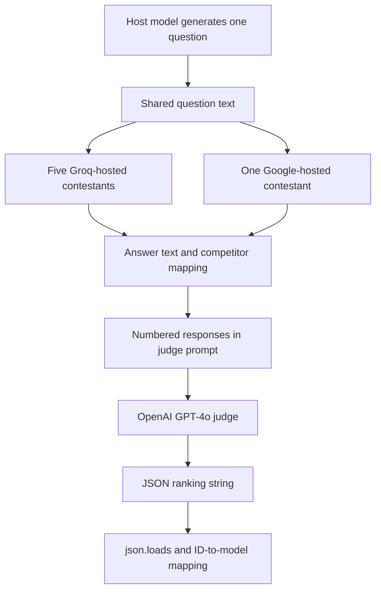

# Multi-LLM Evaluation Framework

### One shared question. Six model responses. A separate model-generated ranking.

A **Python notebook integrating Groq, Google Gen AI, and OpenAI** to run a small comparative LLM experiment. A host model generates a question, six contestants answer it, and a separate GPT-4o judge returns a ranking that is parsed and mapped back to model names.

The repository includes the generated question, saved contestant responses, judge output, and final ranked display. Its engineering focus is coordinating different provider APIs and normalizing their responses into a shared evaluation flow.

[Explore the notebook](./LLM_Orchestration.ipynb) · [Open in Colab](https://colab.research.google.com/github/FaiazS/Multi-LLM-Evaluation-Framework/blob/main/LLM_Orchestration.ipynb)

> **Scope:** Single-question, LLM-as-judge experiment. The saved ranking is a model preference for these particular responses, not a validated general capability benchmark or a current leaderboard. No model calls or tests were run for this documentation.

---

## The problem this project explores

Comparing models requires more than reading one answer in isolation. A useful first experiment gives multiple models the same task, captures their outputs, and applies a common review step.

This project makes that flow explicit:

1. Generate a challenging question.
2. Send the same question to six configured models.
3. Collect their text responses.
4. Present numbered responses to a separate judge.
5. Parse the ranking and resolve competitor IDs to model names.

It is a starting point for comparative evaluation infrastructure. Statistical rigor, calibrated scoring, and repeatable benchmark coverage remain future work.

## Practical value

| Evaluation need | Implementation approach |
|---|---|
| Use one task across providers | Reuse the host-generated question |
| Integrate different model APIs | Groq chat completions, Google content generation, and OpenAI chat completions |
| Normalize response handling | Store model names and answer text in corresponding lists |
| Separate contestants from the evaluator | Dedicated GPT-4o judge call |
| Resolve rankings to identifiable models | Parse JSON IDs and map them to list positions |
| Inspect an experiment | Saved notebook outputs show each stage |

The intended application is exploratory model comparison. The notebook does not demonstrate improved model-selection decisions, cost savings, or benchmark accuracy.

## Configured models

| Role / competitor ID | Provider | Model identifier in source |
|---|---|---|
| Question generator | Groq | `llama-3.3-70b-versatile` |
| 1 | Groq | `llama-3.3-70b-versatile` |
| 2 | Google | `gemini-2.0-flash` |
| 3 | Groq | `deepseek-r1-distill-llama-70b` |
| 4 | Groq | `qwen-qwq-32b` |
| 5 | Groq | `llama3-8b-8192` |
| 6 | Groq | `mistral-saba-24b` |
| Judge | OpenAI | `gpt-4o-2024-08-06` |

These identifiers describe the committed experiment. Current availability and API compatibility must be checked before rerunning; their presence is not a promise that every endpoint remains supported.

## Workflow



Contestant requests are synchronous calls in separate notebook cells. The implementation does not run them concurrently, schedule a batch benchmark, or use an autonomous agent framework.

### Question generation

The host prompt requests one extremely challenging, nuanced question without an explanation. The saved question combines philosophical concepts, AGI risk, embodied cognition, simulated reality, and consciousness.

That open-ended question has no reference answer or deterministic correctness check in the notebook. Its complexity does not by itself establish that it measures intelligence reliably. The question generator is also one of the contestants; task construction is therefore not independent of every evaluated model family.

### Response collection

The notebook appends identifiers to `competitors` and response strings to `answers`. Provider-specific response objects are reduced to text before comparison.

Answers are combined under numbered headings such as `Response from competitor1`. Explicit model labels are omitted from that combined judge section, but the order is fixed and response content is not sanitized for self-identification or judge-directed instructions. This is not a complete blinded evaluation protocol.

### Judge contract

The judge is asked to compare depth, clarity, and quality, then return only JSON:

```json
{"results": ["1", "2", "3", "6", "5", "4"]}
```

This is the actual saved judge output. The application uses `json.loads` and one-based indexing to map each ID back to a model.

JSON formatting is requested in the prompt. No response schema, structured-output setting, or validation layer checks that the list is a complete permutation of the expected IDs.

## Saved result for this experiment

| Position | Model |
|---:|---|
| 1 | `llama-3.3-70b-versatile` |
| 2 | `gemini-2.0-flash` |
| 3 | `deepseek-r1-distill-llama-70b` |
| 4 | `mistral-saba-24b` |
| 5 | `llama3-8b-8192` |
| 6 | `qwen-qwq-32b` |

This table reproduces the notebook's saved ordering. It does **not** establish which model is best overall or which should be selected for another application.

The judge returns no criterion-level scores or explanations, so the notebook cannot show why one response outranked another. Model outputs vary in length and formatting, and some include additional reasoning-style text; the evaluation does not normalize those differences.

## Evaluation boundaries

- **One question:** No multi-domain dataset, held-out task set, or coverage analysis.
- **One saved ranking:** No repeated trials, confidence estimates, or judge-agreement measurement.
- **Fixed response order:** No shuffled presentation or position-bias check.
- **Broad criteria:** Depth, clarity, and quality are requested without an anchored scoring rubric.
- **No ground truth:** No reference answer, expert labels, or independent factual verification.
- **No comparable resource metrics:** Latency, token use, cost, and generation budgets are not recorded for analysis.
- **Provider defaults:** Sampling and output-length settings are not standardized explicitly across contestants.
- **No judge-input isolation:** Raw contestant text is inserted into the evaluation prompt without a dedicated adversarial-response defense.

These limits define how to interpret the result; they do not diminish the concrete integration work demonstrated by the notebook.

## Implementation considerations

### Mutable notebook state

Rerunning a contestant cell appends another entry to both lists. Rerunning the host question without resetting the collection can also mix answers from different questions. There is no immutable run record tying each response to a question, configuration, and timestamp.

### Ranking validation

Malformed JSON, duplicate IDs, missing contestants, nonnumeric IDs, and invalid positions are not handled explicitly. In particular, zero would map to the final list entry through Python negative indexing rather than represent a valid competitor.

### Dependency setup

The notebook installs `groq` and later `openai`, but imports `from google import genai` without an explicit installation step for its corresponding `google-genai` package. IPython display utilities are also used. There is no dependency lockfile or declared supported Python range.

### Reliability

There is no application-level timeout policy, retry strategy, per-contestant failure record, or resume mechanism. A failed provider call can interrupt the manually executed flow.

## Run in Colab

1. Open the notebook through the link above and review the cells.
2. Configure these Colab Secrets:

   | Secret name | Environment variable assigned |
   |---|---|
   | `LLMProjectKey1` | `GROQ_API_KEY` |
   | `New_GEMINI_API_KEY` | `GOOGLE_API_KEY` |
   | `OpenAI_API_Key` | `OPENAI_API_KEY` |

3. Install compatible `groq`, `google-genai`, and `openai` clients in the notebook environment.
4. Verify model availability before making requests and document any replacement identifiers as a new experiment configuration.
5. Generate or freeze the question, initialize the empty collection lists, then execute each contestant once.
6. Build the judge input, request a ranking, and validate the output before mapping IDs to models.

Each full experiment invokes the host, six contestants, and the judge, consuming applicable provider quota. The judge receives the original question and the collected response text. The saved results were inspected without rerunning the experiment.

## Repository layout

```text
Multi-LLM-Evaluation-Framework/
├── LLM_Orchestration.ipynb
└── README.md
```

The repository does not contain a packaged evaluation service, dashboard, persistent experiment database, or automated test suite.

## Next engineering milestones

1. **Create explicit run records:** Store question, model configuration, response, timestamps, usage, and errors together.
2. **Validate the ranking:** Require each expected competitor exactly once and reject invalid output.
3. **Define a rubric:** Use clear criterion-level scales and retain concise justifications.
4. **Expand task coverage:** Add a fixed question set with reference checks or expert labels where appropriate.
5. **Check judge consistency:** Repeat judgments, shuffle answer order, and compare against human review.
6. **Compare resource tradeoffs:** Record latency, cost, token use, and output budgets alongside quality assessments.
7. **Make execution reproducible:** Pin dependencies, centralize provider adapters, and add bounded concurrency with error isolation.

These are proposed improvements, not implemented benchmark capabilities.

## Skills demonstrated

**Python · Multi-provider LLM integration · Prompt engineering · Response normalization · LLM-as-judge orchestration · JSON parsing · Result mapping · Notebook experiment design**

The strongest portfolio contribution is bringing several model APIs into one inspectable comparison flow. Turning that experiment into a dependable evaluation framework requires broader tasks, validated outputs, repeatable configuration, and calibration of the judge's preferences.

---

**Author:** [Faiaz Ahmed](https://www.linkedin.com/in/faiazahmed22/) · [GitHub](https://github.com/FaiazS)
